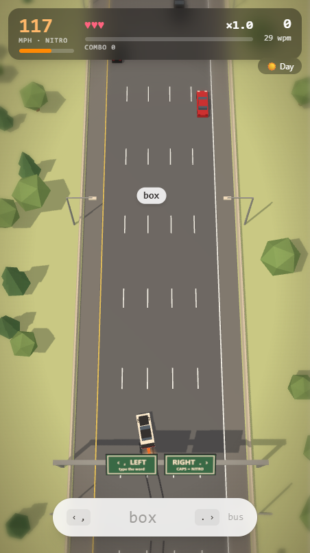
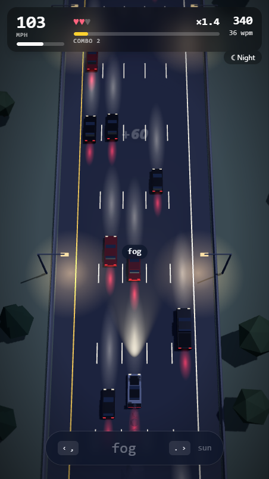
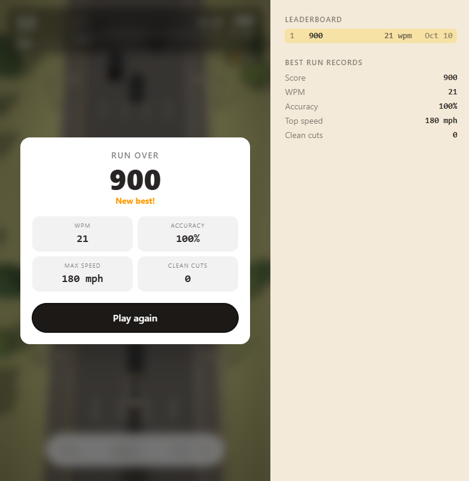

# Typencut

[](https://github.com/4bdulllahh/typencut/actions/workflows/ci.yml)

A browser speed-typing game: weave a Porsche 911 GT3 RS through highway traffic by typing words. Inspired by *Assetto Corsa: No Hesi* weaving, styled after *Art of Rally*'s low-poly, flat-shaded look.

<p>
  
  
  
</p>

## How to play
- Type the word shown in the dock (it also floats over the next car in your lane), then press **`,`** to move one lane left or **`.`** to move one lane right.
- Type the word in **ALL CAPS** for a one-second nitro burst.
- Press **Enter twice** with an empty input to brake for a second.
- Overtake for points: +50 standard, +100 when you pass close in the next lane, **+500 clean cut** when you dodge out from right behind a car. Passes without contact build a multiplier up to 5×. Three crashes and the run is over.
- Words start at three letters and grow longer (with mixed casing) as you go.
- Black cars hold their lane. Red cars change lanes, usually after flashing an indicator, sometimes without warning.
- Toggle day/night top right. Your top 10 runs and best-ever stats are saved in this browser.

## Tech
Next.js 16 · React 19 · React Three Fiber · three.js · Tailwind CSS 4 · Web Audio API (all sounds synthesised). No backend, no assets: every car, tree and sign is built from code.

The game logic in `src/game/` is plain TypeScript with no React or three.js, so it runs and is tested in Node. Input becomes commands (`engine.send`), the simulation emits events (`engine.on`), and the renderer only reads state: the seams a multiplayer or ghost-car layer would use.

```
src/game/          sim, input matching, engine loop, words, audio, leaderboard (+ Node tests)
src/components/    Game (layout, HUD wiring), TypingDock (keys → commands), Hud
  scene/           Scene (canvas, camera, word tag), World (road), Vehicles, Fx
```

## Develop
```bash
npm install
npm run dev         # http://localhost:3000
npm test            # sim, input and leaderboard tests (node --test)
npm run typecheck
npm run build
node scripts/shot.mjs http://localhost:3000 shots [--night]   # headless playthrough + screenshots (needs Chrome)
```
Node 22.18 or newer. CI runs typecheck, tests and build on every push and pull request.

## Deploy
Import the repo on [Vercel](https://vercel.com/new); the Next.js defaults work with no extra config.

## License
MIT
