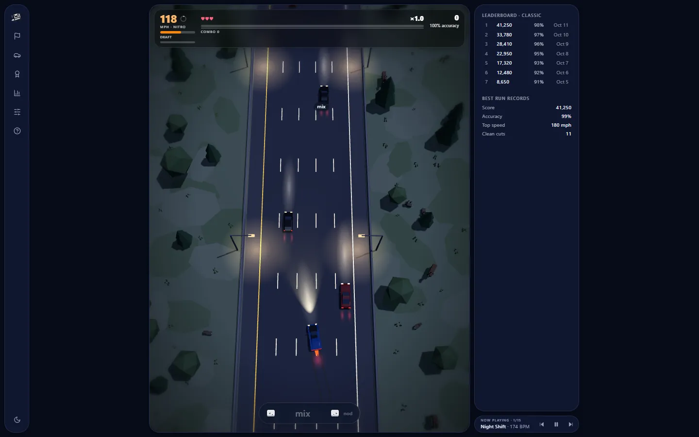
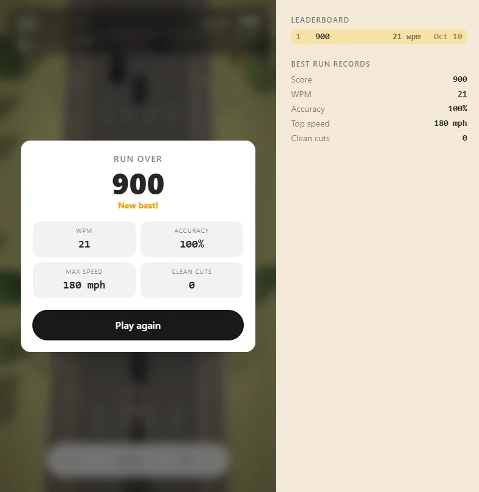
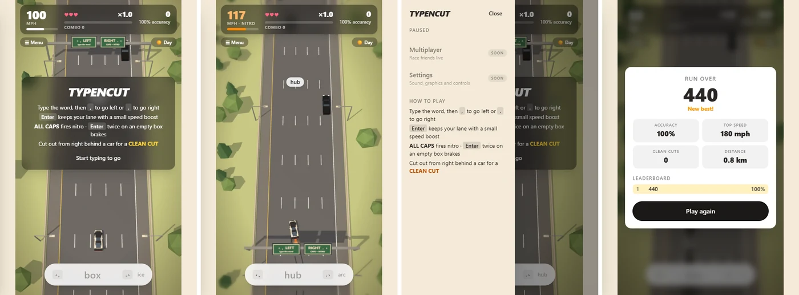
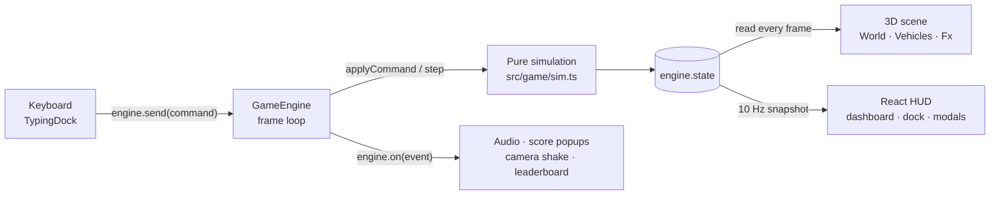

# Typencut

Type to weave a Porsche 911 GT3 RS through highway traffic.

A browser speed-typing game inspired by *Assetto Corsa: No Hesi* highway weaving, drawn in the flat-shaded, low-poly style of *Art of Rally*. Every word you type moves you: finish it with a comma to go one lane left, a full stop to go right, or Enter to hold your lane with a burst of speed. Shout it in ALL CAPS for nitro, and tap Enter twice to brake. Slip past black cruisers and lane-hopping red mergers, chain close passes into a 5× multiplier, and cut out from right behind a car for a 500-point CLEAN CUT. No account, no server and no downloads: every car, tree, sign and sound is generated in code.

**Live:** https://typencut-two.vercel.app · **Version:** 1.8.0

[](https://vercel.com/new/clone?repository-url=https%3A%2F%2Fgithub.com%2F4bdulllahh%2Ftypencut&project-name=typencut&repository-name=typencut)
[](https://github.com/4bdulllahh/typencut/actions/workflows/ci.yml)
[](LICENSE)

<p align="center"></p>

## Features

- **Typing is steering.** Type the word in the dock, then press **`,`** to move one lane left, **`.`** to move one lane right (or your own keys: any key but a letter, Enter, Backspace, Tab, Escape, Shift or Caps Lock can be set in Settings; the overhead signs follow), or **Enter** to stay in your lane with a short speed boost (+12 mph for under a second). The same word floats over the next car in your lane, so your eyes can stay on the road. Letters turn green or red as you type; a wrong word shakes the dock and the car stays put.
- **Nitro and brakes.** Type the word in **ALL CAPS** and the car surges toward 180 mph for one second with exhaust flames, camera shake and a wider field of view. Press **Enter twice** within 350 ms with the dock empty to brake hard for a second, with the full-width LED strip lit.
- **Traffic with two personalities.** Five black cruisers (Toyota Yaris, Honda Civic, Chevrolet Malibu, Nissan Rogue, Ford F-150) hold their lane at a steady speed: 85 to 95 mph in the far-left lane, 60 to 80 mph elsewhere. Three red mergers (BMW M3, Mercedes-Benz C63 AMG, Audi A5) change lanes: usually they flash an amber indicator for 1.5 to 2 seconds first, but 12% of the time they cut straight across without warning.
- **Scoring that rewards risk.** +50 for a pass, +100 for a close pass in the next lane, **+500 for a clean cut**: dodging out from right behind a car and passing it. Every pass without contact raises the multiplier by 0.2×, up to 5×. A crash costs one of three lives and resets it.
- **Keep moving.** Each pass refills a six-second combo timer, shown as a thin line under the multiplier. Stop passing and the multiplier drains one step a second.
- **Slipstream.** Sit close behind a car in your lane and the draft meter under the speedometer fills, faster the closer you are. When it reads "nitro ready", your next word fires a free nitro, perfect for cutting out from behind that same car. Partial fills carry over between cars.
- **Speed traps.** The roadside speed cameras carry a 150 mph sign. Blast past one at 150 or faster (cruising tops out at 140, so time a nitro) for a bonus of 200 points plus 10 for every mph over, times your multiplier, with a camera flash and a SPEED TRAP banner.
- **Traffic without dead stretches.** Every lane is refilled on its own, so cars stay evenly spread across all five lanes: about eight in view on average and never an empty road.
- **Hearts.** Now and then a floating, spinning heart rides above a lane (6.5% of the cars that would appear become one, so roughly one every 8 seconds in Classic). Drive through it to win back a life, up to three. Zen has none.
- **Six modes.** Classic (three lives, endless road), Drive (no typing: **A**/**D** or **←**/**→** switch lanes, **W**/**↑** gives a short burst of speed and a quick double tap fires nitro, **S**/**↓** brakes; phones get four buttons), Zen (crashes cost no lives; end the run from the menu), Rush hour (traffic nearly twice as dense), Time attack (best score in 90 seconds, with a countdown on the dashboard) and a Daily challenge. Each mode keeps its own leaderboard.
- **Daily challenge.** A run seeded from today's date (UTC), so everyone starts on the same road with the same words, under Classic rules. It keeps a separate best for each day.
- **Word packs.** Driving, Common English, Programming, Spanish, French or German, or paste your own list. Every pack is sorted by word length, so the difficulty still ramps from short words to long ones.
- **Achievements.** Sixteen of them, from your first clean cut to 5 km without a crash, five speed traps in a run or 20,000 points in Time attack. They pop up the moment you earn them, and the menu lists which you have.
- **Garage.** Every finished run adds its score to your lifetime points, which unlock five more paints (Guards red, Shark blue, Python green, Lava orange, Black) and two more cars: a Porsche 911 Turbo S and a BMW M4 Competition. Pick them in the menu.
- **Share card.** The game-over card's Share button makes a square image of your run (score, mode, accuracy, top speed, clean cuts, distance). On a phone it opens the share sheet; on a computer it downloads.
- **Gets harder as you go.** Your cruising speed climbs from 100 to 140 mph, traffic gets about 70% denser, and words grow from three letters to seven or more, with mixed casing (`DrIft`) that must be typed exactly.
- **Cars you can recognise.** Every model has its own shaped body, built from its real side profile and plan taper: the 911's fastback and raised front wings, the Yaris's short hatch, the Civic's sloping fastback, the Malibu's long three-box sedan, the Rogue's tall SUV body with roof rails, the F-150's cab and open bed, and the sporty M3, C63 and A5. Each has glass where its windows are, mirrors, its own wheelbase and its own head- and taillight layout.
- **A car that shows the damage.** The starting GT3 RS has a white body, carbon hood and roof, fender louvers, a swan-neck wing, dual centre exhausts and a red LED tail strip. After one crash it carries scuffs and trails light smoke; after two it is dented, with a popped hood, a hanging bumper and thick black smoke. Hard lane changes and braking leave skid marks on the asphalt.
- **Day and night.** A warm pastel day with soft shadows, or a night drive with lit streetlights, headlight beams, a real spotlight from your car, and a soft red glow on the road behind each taillight, placed where that car's lamps really are (corner lamps on most cars, tall slim lamps on the F-150, one full-width strip on the GT3 RS) and stretching with speed. The toggle is top right and your choice is remembered.
- **Weather.** Rain brings falling streaks, spray kicked up behind every car, a darker glossy road where taillights and streetlights stretch into long reflections at night, a grey overcast sky and the hiss of rain. Fog hangs a thick haze over the road that swallows traffic about 100 m ahead, so cars appear later. Pick Clear, Rain or Fog in Settings, or leave it on Random for a new roll each run (half clear, 30% rain, 20% fog). The weather changes only what you see and hear; the car drives the same.
- **Synthesised sound.** An engine note that climbs through a seven-speed gearbox as you speed up, drops on every upshift and howls on nitro. A soft linear-switch key click (duller on a wrong letter), a turbo blow-off on nitro, a rising whoosh on an Enter boost, tyre screech on lane changes and braking, a horn when you pass close, and a thud when you crash. All generated live with the Web Audio API.
- **Accuracy over speed.** You type when a gap opens, not as fast as you can, so the game tracks accuracy rather than words per minute. The digital dashboard shows speed, lives, multiplier, score and live accuracy. At game over you get score, accuracy, top speed, clean cuts and distance. Your top 7 runs and best-ever stats for the current mode sit in a card on wide screens, in the rail's Leaderboard panel, and on the game-over card on smaller screens.
- **Rail and settings.** Soft rounded panels throughout. An icon rail on the right (a row above the game on phones) widens to show its labels when you hover or tab into it. Each item opens one panel beside it and pauses the game: Mode & words (pick the mode and word pack, end the current run), Garage, Achievements, Leaderboard, Settings and How to play. The Day/Night switch sits at the foot of the rail. Settings holds volume, mute, engine sound on or off, graphics quality (Low drops shadows and renders at 1× for slower devices), weather (Random, Clear, Rain or Fog), reduce motion (no camera shake, nitro zoom or edge blur; on by default if your system asks for less motion), and on-screen controls. Your choices are remembered. Multiplayer has its place ready.
- **Phone controls.** Left, straight and right buttons above the dock, on by default on touch screens. They submit the word you've typed without closing the phone's keyboard, the middle one doubles as the brake (tap twice on an empty box), and crashes vibrate on phones that support it.
- **One typeface, phone to desktop.** Everything uses the same system sans (Segoe UI on Windows, San Francisco on Apple devices), and the road stays in a 3:4 column at any window size.

| Day: a nitro lane change, with exhaust flames and skid marks | Game over, with the leaderboard sidebar |
| --- | --- |
|  |  |

<p align="center"></p>

## Privacy

Typencut has no backend. The game runs entirely in your browser and makes no network requests after the page loads: no analytics, cookies, accounts or third-party fonts. It remembers four kinds of thing, all in your browser's localStorage: your day/night choice (`typencut.theme`), your settings, including your mode, word pack, your own word list, car, paint, weather and lane-switch keys (`typencut.settings`), your lifetime points and achievements (`typencut.progress`), and your leaderboards (`typencut.board` for Classic, `typencut.board.<mode>` for the others, `typencut.board.daily.<date>` for each daily challenge). Clearing site data resets them. The share card is drawn in your browser and goes only where you send it.

## Principles

- **The simulation comes first.** All game rules live in plain TypeScript with no React, three.js or DOM, so they run and are tested in Node. The 3D scene and HUD only read the game state; they never change it.
- **Everything goes through one door.** Keystrokes become commands (`engine.send`), and the simulation reports what happened as events (`engine.on`). That is the seam a ghost car or a WebSocket multiplayer layer would plug into.
- **No assets.** Cars, trees, signs, glows and sounds are all built in code, so there is nothing to download but the app itself.
- **Zero cost.** A Next.js app on Vercel's free tier with no backend to run or pay for.

## Tech stack

| Area | Choice |
| --- | --- |
| Framework | Next.js 16 (App Router) + React 19 + TypeScript 5.9 (strict) |
| 3D | three.js 0.186 through React Three Fiber 9; flat-shaded `MeshStandardMaterial`, physical light units, no tone mapping |
| Styling | Tailwind CSS 4 (configured in CSS), system fonts |
| Audio | Web Audio API: oscillators and filtered noise, no samples |
| Storage | localStorage, validated on every load |
| Quality | `node --test` (Node runs TypeScript directly), `tsc --noEmit`, GitHub Actions CI, a headless-Chrome playthrough script with no dependencies |
| Hosting | Vercel, zero configuration |

## How typing becomes driving

[`TypingDock`](src/components/TypingDock.tsx) is the only place keystrokes turn into game commands. It keeps an invisible text input over the capsule (and refocuses it if focus wanders), and reads the target word straight from the engine at key time, so fast typists never race a stale word.

- **Each letter** is checked as a prefix of the target, ignoring case, and counted for accuracy. Case is only judged when you submit.
- **`,` or `.`** (or `<` and `>`) submits and steers one lane. **Enter** submits without steering and gives a short boost. An exact match counts; the same letters in ALL CAPS also fire nitro (with Enter, nitro without changing lane), and so does any correct word while the draft meter is full; anything else is a miss. Steering into a wall is ignored, but the word still counts.
- **Enter twice** within 350 ms with the dock empty brakes. An Enter that submits a word never counts toward a brake.
- **Accuracy** is correct keystrokes over all keystrokes, including the submitting key. There is no WPM: you wait for gaps in traffic, so typing speed says little about how well you drive.

Words come from the chosen pack, sorted into five length buckets (3 or fewer, 4, 5, 6 and 7+ letters): Driving (221 words), Common English (167), Programming (129), Spanish (79), French (75) and German (70). The language packs use words without accents or special letters, so they can be typed on any keyboard. Your own list keeps words of 2 to 14 letters (A–Z only), lowercased and without repeats; it needs at least 10, or the Driving words are used instead. Until difficulty reaches 5% you only get the shortest words; after that a weighting window slides toward longer ones, skipping buckets a pack has no words for. Past 35% difficulty some words get mixed casing. A prompt is never all caps, because all caps means nitro.

## How the simulation works

[`src/game/sim.ts`](src/game/sim.ts) holds the whole game in one plain object and advances it once per animation frame, with each step capped at 50 ms so a stalled tab can't teleport the cars. The world is measured in metres along the road (`s`) and across it (`x`), with five 3.6 m lanes.

- **Difficulty** runs from 0 to 1 as distance and score add up (8 km on its own, or 60,000 points on its own, would max it out), and drives cruise speed, traffic density and word length.
- **Lane changes** use a critically damped spring, which settles in about half a second without overshoot.
- **Nitro** pulls speed toward 180 mph for one second. An **Enter boost** pulls it 12 mph above cruise for 0.8 seconds. **Braking** pulls it toward 40% of cruise speed for one second.
- **Traffic** is spawned per lane, 200 m ahead (just past the fog). Each lane gets its next car once its last one has drifted a random 54 to 126 m behind that line, shrinking to 31 to 73 m at full difficulty. Spawning from one road-wide car count left empty stretches: far-left-lane cars drive almost as fast as you, so they stayed in view for a long time and used up the count, starving the other lanes. A test now fails if the view is ever left with fewer than three cars. Cars are removed 40 m behind or 460 m ahead. Every car follows the one in front: it matches its speed inside 25 m and brakes below it inside 6 m, so cars never drive through each other. Mergers reconsider every 2 to 6 seconds, only move into a clear lane, and never swerve into a player already alongside, since that crash would be unavoidable.
- **Modes.** Zen skips losing a life on a crash (the rest of the crash still happens), Rush hour multiplies every lane gap by 0.55, Time attack ends the run after 90 seconds of running time, and an `end` command finishes any run from the menu. The daily seed is an FNV-1a hash of the UTC date. Because traffic spawns relative to the player, roads diverge once players drive differently; what's shared is the starting road and the random sequence.
- **Combo timer.** Every pass sets a 6-second timer. When it runs out the combo drops by one (multiplier −0.2×) and the timer restarts at one second, so a stall drains the multiplier step by step rather than all at once.
- **Slipstream.** While a car is ahead in your lane with less than 16 m between bumpers, the draft meter fills at up to 3 per second, scaled by how close you are (0 at 16 m, full rate at touching distance). Away from one it fades by 0.25 per second. Once full it stays full until a word spends it.
- **Speed traps.** Cameras stand every 360 m from the 35 m mark (`SPEED_CAMERA` in `config.ts`, shared by the sim and the scene). Crossing one at 150 mph or more scores (200 + 10 × mph over 150) × multiplier. Speed traps add score but don't count as passes.
- **Crashes** use the cars' real footprints. A hit costs a life, halves your speed, cancels nitro, resets the combo, nudges you sideways and makes you untouchable for two seconds (the car blinks).
- **Randomness** comes from a seeded generator (mulberry32) stored in the state, so the same seed and the same inputs replay the same run. That is tested, and it is what a ghost car would need.

## How scoring works

| Event | Rule | Points |
| --- | --- | --- |
| Standard | Passing a car with more than 2 m of side gap | 50 |
| Close pass | Passing with under 2 m of side gap, usually in the next lane | 100 |
| Clean cut | Passing the car you steered out from behind, if its bumper was under 12 m ahead when you switched lanes | 500 |
| Speed trap | Passing a roadside camera at 150 mph or more | 200 + 10 per mph over |

Points are multiplied by your multiplier when scored. The multiplier is 1 + 0.2 × your current combo (passes since the last crash, drained by the combo timer), capped at 5×. Cars you hit don't count as passes.

## How the world is drawn

- **Player-relative.** The player car always sits at the origin and everything else is placed at `z = −(s − player.s)`, so the numbers stay small at any distance. Forward is −z.
- **Infinite road from a few copies.** A `Repeat` component keeps only the copies inside a window from 25 m behind to 140 m ahead and moves them as you drive: lane dashes every 12 m, trees every 6 m (each keeps its look by hashing its index), streetlights every 42 m, speed cameras every 360 m and gantry signs every 520 m. Fog hides the far end of the window.
- **Camera.** 90 m up and 10 m behind, tilted 20° from straight down, following 35% of your sideways movement. It shakes on crashes, nitro and clean cuts, and widens its field of view by 8° during nitro. A speed-scaled blur on the screen edges and a vignette sit on top.
- **Cars from profiles.** Each model's body is lofted through about ten cross-sections traced from the real car: for each one, its position along the car, its width, the waist height, the roof height where there is a cabin, and how far the front wings stand above the hood. Every cross-section is a 12-point ring (sill, side, shoulder, wing, glasshouse base, roof edge, mirrored), and neighbouring rings are joined into faces. Steep roof segments become the windscreen and rear window, and cabin sides become side windows. Each geometry is built once per model and shared. Wheels, mirrors, lamps, roof rails and the F-150's bed are added on top, and footprints use real-world dimensions, so what you see is what you hit (the unlockable player cars share the GT3 RS's hitbox, so they change only the looks):

| Model | Role | Length × width (m) |
| --- | --- | --- |
| Porsche 911 GT3 RS (2022) | Player | 4.57 × 1.90 |
| Porsche 911 Turbo S (2021) | Player, unlocked at 100,000 lifetime points | 4.54 × 1.90 |
| BMW M4 Competition (2021) | Player, unlocked at 200,000 lifetime points | 4.79 × 1.89 |
| Toyota Yaris (2015) | Cruiser | 3.95 × 1.70 |
| Honda Civic (2020) | Cruiser | 4.67 × 1.80 |
| Chevrolet Malibu (2015) | Cruiser | 4.92 × 1.85 |
| Nissan Rogue (2016) | Cruiser | 4.65 × 1.84 |
| Ford F-150 (2017) | Cruiser | 5.89 × 2.03 |
| BMW M3 (2015) | Merger | 4.67 × 1.88 |
| Mercedes-Benz C63 AMG (2012) | Merger | 4.73 × 1.80 |
| Audi A5 (2014) | Merger | 4.63 × 1.85 |

- **Effects.** Skid marks are one instanced mesh of 240 road-space segments laid under the rear tyres while you swerve or brake. Smoke is a pool of 48 puffs. Glows and beams share a radial texture drawn on a canvas; taillight pools use a softer, near-gaussian one.
- **Weather.** Each weather has its own sky, fog distances and light balance (overcast skies trade direct sun for sky light). Rain is 700 instanced streaks in a box around the car, each stretched along its speed relative to you, falling at 26 m/s and rushing past at your speed. Spray is a pool of 360 soft mist patches left in road space behind each car's rear wheels, so it streams away behind cars you pass fast. The wet road swaps in darker, glossier asphalt, and the taillight and streetlight pools turn into long, narrow streaks. Random weather is rolled from the run's seed, so the daily challenge has the same weather for everyone and Play again rolls a new one.
- **Light.** three.js uses physical light units, so the day lights are balanced to sum to about π, which keeps the flat colours bright without washing out. The sun's shadow box follows the player.
- **Performance.** Positions are written to three.js objects every frame without going through React. React re-renders the traffic only when a car appears or leaves, and the HUD at 10 Hz plus on every event. Geometries and materials are shared between all copies.

## How the sound is made

[`src/game/audio.ts`](src/game/audio.ts) listens to game events and builds each sound from oscillators and filtered white noise. The audio context starts on your first keystroke, as browsers require. Everything runs through one master volume (the Volume and Mute settings), and the engine note goes quiet while the menu is open or the run is over.

| Event | Sound |
| --- | --- |
| Engine | A sawtooth plus a square an octave below, through a resonant low-pass that opens with the revs. Speed maps to a simulated seven-speed gearbox (upshifts at 40, 62, 85, 108, 132 and 158 mph); within a gear the pitch climbs from 35% to 100% revs, then drops on the shift. Nitro makes it louder and brighter. Updated 20 times a second with smooth glides. |
| Rain | Looped white noise through a wide band-pass around 1.8 kHz, faded in while it rains |
| Keystroke | A low sine "thock" plus a short band-passed click; a wrong letter sounds duller, and every key varies slightly in pitch |
| Nitro | A falling band-passed hiss (turbo blow-off) over a low-passed whoomp (flame) |
| Enter boost | A short rising whoosh |
| Lane change | A short, narrow tyre screech |
| Brake | A longer screech |
| Draft meter full | A rising triangle-wave chirp |
| Speed trap | A high-passed shutter click and a bright two-note chime |
| Close pass or clean cut | A two-tone horn that drops in pitch as you pull away |
| Crash | A falling low sine thud with a burst of low noise |

## Leaderboard

[`src/game/leaderboard.ts`](src/game/leaderboard.ts) keeps one board per mode (Classic keeps the original key, so v1 boards carry over) and one per day for the daily challenge. Each keeps your top 7 runs by score and, separately, your best value for every stat (score, accuracy, top speed, clean cuts), so a record set in a low-scoring run still counts. Anyone can edit localStorage, so the stored board is validated on every load: any entry that isn't a complete set of finite numbers is dropped instead of breaking the page. Runs saved by v1.0 still load; their old WPM field is ignored. Both rules are tested.

## Progression

[`src/game/progress.ts`](src/game/progress.ts) holds the achievements, the unlock costs and your lifetime points. Achievements are checked against the live run on every game event (and once more at game over), so each one pops up the moment it is earned; each is earned once and stored with its date. A finished run adds its score to your lifetime points, and the game-over card lists anything that crossed. The stored record is validated on load like the leaderboard: a total that isn't a non-negative number becomes 0, and unknown or malformed achievements are dropped. A car or paint you haven't unlocked can't be picked, and a locked one in edited storage falls back to the white GT3 RS.

| Unlock | Lifetime points |
| --- | --- |
| White 911 GT3 RS | from the start |
| Guards red paint | 15,000 |
| Shark blue paint | 40,000 |
| Python green paint | 80,000 |
| 911 Turbo S | 100,000 |
| Lava orange paint | 150,000 |
| M4 Competition | 200,000 |
| Black paint | 250,000 |

| Achievement | How |
| --- | --- |
| Clean cut · Surgeon | 1 clean cut · 5 in one run |
| On a roll · Full send | 10 passes in a row · reach the ×5 multiplier (20 in a row) |
| Century | 100 passes in one run |
| Say cheese · Most wanted | 1 speed trap · 5 in one run |
| Slipstreamer | fire a free nitro from the draft |
| Clean sheet | 5 km without a crash |
| Five figures · High roller | 10,000 · 50,000 points in one run |
| Sharpshooter | 100 words at 98% accuracy or better |
| Beat the clock | 20,000 points in Time attack |
| Gridlock | 50 passes in Rush hour |
| Zen garden | 10 km in Zen |
| Daily driver | finish a daily challenge |

The share card is a 1080 × 1080 canvas drawn in the page's own font ([`src/components/shareCard.ts`](src/components/shareCard.ts)). It goes to `navigator.share` when the browser can share image files, and is downloaded as `typencut-run.png` otherwise.

## Architecture



| Folder | What's in it |
| --- | --- |
| `src/game` | Framework-free game: config and car footprints, simulation, input matching, words, engine loop, audio, leaderboard, achievements and unlocks, and their Node tests |
| `src/components` | `Game` (layout, theme, wiring), `TypingDock` (keys → commands), `Rail` (the right-hand icon rail and Day/Night switch), `Hud` (dashboard, popups, start card, game over, leaderboard, the menu panels: mode, garage, achievements, settings, help), `shareCard` (the result image) |
| `src/components/scene` | `Scene` (canvas, lights, camera rig, traffic, floating word), `World` (road and roadside), `Vehicles` (cars and night lights), `Fx` (skid marks, smoke), shared canvas textures |
| `src/app` | Next.js layout and page; the game loads client-side only |
| `scripts` | `shot.mjs`: a headless-Chrome playthrough that saves screenshots and reports console errors |

## Accessibility

- The whole game is played from the keyboard. The game-over card is a labelled dialog whose Play again button takes focus, so Enter starts the next run.
- The rail is a labelled navigation landmark whose buttons say which panel they open; it widens on keyboard focus as well as hover. A panel opens with focus on Close, Escape or a click outside closes it, and the game pauses while it is open.
- The typing input is labelled with the current word and the controls, including rebound lane-switch keys. Each key-picker button says which key it holds and when it is waiting for a new one; Escape cancels a pick, and a refused key is explained in a status message. Drive mode needs no typing at all. Score popups are announced politely to screen readers, and the hearts have a text label.
- **Reduce motion** (in Settings, and on by default when your system asks for less motion) removes camera shake, the nitro zoom and the edge blur, and score popups fade instead of flying.
- Settings use native controls (a slider, checkboxes and radio buttons, including the weather choice), so they work with the keyboard and screen readers. Paint swatches are buttons named after the paint, and a locked one says how many points unlock it. New achievements are announced as a status message.
- It is a fast visual game at heart: the traffic itself can't be followed with a screen reader.

## Getting started

Requires Node.js 22.18 or later (CI uses 24).

```bash
npm install
npm run dev        # http://localhost:3000
```

## Scripts

| Command | What it does |
| --- | --- |
| `npm run dev` | Development server with hot reload |
| `npm run build` | Production build |
| `npm start` | Serve the production build |
| `npm test` | Simulation, modes, word packs, input, leaderboard, achievements and unlocks, settings, weather, engine-sound, Drive mode, heart and key-binding tests (32, with `node --test`) |
| `npm run typecheck` | Type check with `tsc --noEmit` |
| `node scripts/shot.mjs <url> <outDir> [--night]` | Plays a run in headless Chrome (eight words including two nitros and one Enter submit, a brake, then idles until game over), saves six screenshots and prints any console errors. Set `CHROME` if Chrome isn't in its default Windows location |

CI runs the type check, tests and production build on every push and pull request.

## Deploy your own

- **Vercel:** click **Deploy with Vercel** above. No configuration is needed.
- **Any Node host:** `npm ci && npm run build && npm start` (set `PORT` to choose the port).

## Limitations

- **Keyboard first.** It is designed for a physical keyboard. The phone controls were tested in a phone-sized headless browser, not yet on real devices, and the on-screen keyboard covers part of the road. Vibration works on Android browsers but not on iPhones, which don't allow it.
- **Multiplayer** in the menu is a placeholder for now.
- **System font.** The typeface is your device's own sans, so it differs a little between Windows, macOS and Linux.
- **Local leaderboard.** Runs, achievements and unlocks are saved only in the browser you played in, without names. There is no online leaderboard, and anyone can unlock everything by editing localStorage.
- **Word packs** have no accented letters: the Spanish, French and German packs use words without accents or umlauts.
- **The daily challenge** shares the starting road and the random sequence, not every car: traffic spawns relative to each player, so roads drift apart as people drive differently.
- **Overlapping text.** The floating word can overlap score popups when several land at once.

## Roadmap

- [x] **M1** Foundation: Next.js scaffold, pure-TypeScript simulation (traffic, steering, nitro, brake, scoring, collisions, words), input matching, engine loop, Node tests, a playable scene of boxes with typing input
- [x] **M2** World: low-poly road with dashes, shoulders, barriers, gantries, speed cameras, streetlights and trees; tilted follow camera with shake and nitro field of view; day and night lighting; vignette and edge blur
- [x] **M3** Vehicles: the procedural GT3 RS plus five black cruisers and three red mergers, indicators, brake lights, night headlights, beams and taillight trails, player damage states
- [x] **M4** Effects and audio: nitro exhaust flames, skid marks, engine smoke, the Web Audio synth (key click, blow-off, screech, horn, thud)
- [x] **M5** HUD and meta: digital dashboard, floating words over traffic, CLEAN CUT callouts, leaderboard sidebar, start card, game-over telemetry, responsive layout
- [x] **M6** Polish and release: handling tuning, CI, screenshots, documentation (v1.0.0)
- [x] **v1.1** Enter to hold your lane with a boost, recognisable lofted car bodies, per-car taillight glows, even traffic in every lane, accuracy instead of WPM, one typeface, left menu with pause
- [x] **M7** Settings and feel: volume and mute, graphics quality, reduce motion, an engine note that rises with speed, on-screen phone controls (v1.2.0)
- [x] **M8** Gameplay: slipstream meter, speed-trap bonuses at the roadside cameras, a combo timer (v1.3.0)
- [x] **M9** Modes and content: Zen, Rush hour and Time attack modes, word packs, a daily challenge (v1.4.0)
- [x] **M10** Progression: achievements, unlockable paints and cars, a shareable result card (v1.5.0)
- [x] **M11** Weather: rain and fog (v1.6.0)
- [x] **M12** Layout: soft rounded panels, a right-hand rail that widens on hover with Day/Night in it, a wider 3:4 road, top 7 leaderboard (v1.7.0)
- [x] **M13** Drive mode (WASD or arrow keys, no typing), heart pickups on the road, your own lane-switch keys (v1.8.0)

## License

MIT
