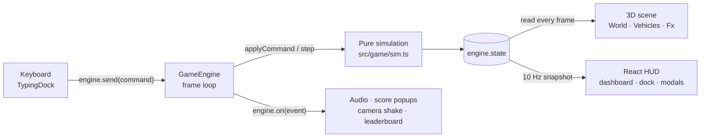

# Typencut

Type to weave a Porsche 911 GT3 RS through highway traffic.

A browser speed-typing game inspired by *Assetto Corsa: No Hesi* highway weaving, drawn in the flat-shaded, low-poly style of *Art of Rally*. Every word you type steers one lane: finish it with a comma to go left or a full stop to go right, shout it in ALL CAPS for nitro, and tap Enter twice to brake. Slip past black cruisers and lane-hopping red mergers, chain close passes into a 5× multiplier, and cut out from right behind a car for a 500-point CLEAN CUT. No account, no server and no downloads: every car, tree, sign and sound is generated in code.

**Live:** https://typencut-two.vercel.app · **Version:** 1.0.0

[](https://vercel.com/new/clone?repository-url=https%3A%2F%2Fgithub.com%2F4bdulllahh%2Ftypencut&project-name=typencut&repository-name=typencut)
[](https://github.com/4bdulllahh/typencut/actions/workflows/ci.yml)
[](LICENSE)

<p align="center"></p>

## Features

- **Typing is steering.** Type the word in the dock, then press **`,`** to move one lane left or **`.`** to move one lane right. The same word floats over the next car in your lane, so your eyes can stay on the road. Letters turn green or red as you type; a wrong word shakes the dock and the car stays put.
- **Nitro and brakes.** Type the word in **ALL CAPS** and the car surges toward 180 mph for one second with exhaust flames, camera shake and a wider field of view. Press **Enter twice** within 350 ms with an empty dock to brake hard for a second, with the full-width LED strip lit.
- **Traffic with two personalities.** Five black cruisers (Toyota Yaris, Honda Civic, Chevrolet Malibu, Nissan Rogue, Ford F-150) hold their lane at a steady speed: 85 to 95 mph in the far-left lane, 60 to 80 mph elsewhere. Three red mergers (BMW M3, Mercedes-Benz C63 AMG, Audi A5) change lanes: usually they flash an amber indicator for 1.5 to 2 seconds first, but 12% of the time they cut straight across without warning.
- **Scoring that rewards risk.** +50 for a pass, +100 for a close pass in the next lane, **+500 for a clean cut**: dodging out from right behind a car and passing it. Every pass without contact raises the multiplier by 0.2×, up to 5×. A crash costs one of three lives and resets it.
- **Gets harder as you go.** Your cruising speed climbs from 100 to 140 mph, traffic doubles from 10 to 20 cars, and words grow from three letters to seven or more, with mixed casing (`DrIft`) that must be typed exactly.
- **A car that shows the damage.** The GT3 RS has a white body, carbon hood and roof, fender louvers, a swan-neck wing, dual centre exhausts and a red LED tail strip. After one crash it carries scuffs and trails light smoke; after two it is dented, with a popped hood, a hanging bumper and thick black smoke. Hard lane changes and braking leave skid marks on the asphalt.
- **Day and night.** A warm pastel day with soft shadows, or a night drive with lit streetlights, headlight beams, a real spotlight from your car and long red taillight trails. The toggle is top right and your choice is remembered.
- **Synthesised sound.** A soft linear-switch key click (duller on a wrong letter), a turbo blow-off on nitro, tyre screech on lane changes and braking, a horn when you pass close, and a thud when you crash. All generated live with the Web Audio API.
- **Telemetry and a leaderboard.** A digital dashboard shows speed, lives, multiplier, score and live WPM. At game over you get score, WPM, accuracy, top speed and clean cuts. Your top 10 runs and best-ever stats sit in a sidebar on wide screens and on the game-over card on smaller ones.
- **Phone to desktop.** The road stays in a 9:16 portrait column at any window size.

| Day: a nitro lane change, with exhaust flames and skid marks | Game over, with the leaderboard sidebar |
| --- | --- |
|  |  |

<p align="center"></p>

## Privacy

Typencut has no backend. The game runs entirely in your browser and makes no network requests after the page loads: no analytics, cookies, accounts or third-party fonts. It remembers two things, both in your browser's localStorage: your day/night choice (`typencut.theme`) and your leaderboard (`typencut.board`). Clearing site data resets both.

## Principles

- **The simulation comes first.** All game rules live in plain TypeScript with no React, three.js or DOM, so they run and are tested in Node. The 3D scene and HUD only read the game state; they never change it.
- **Everything goes through one door.** Keystrokes become commands (`engine.send`), and the simulation reports what happened as events (`engine.on`). That is the seam a ghost car or a WebSocket multiplayer layer would plug into.
- **No assets.** Cars, trees, signs, glows and sounds are all built in code, so there is nothing to download but the app itself.
- **Zero cost.** A Next.js app on Vercel's free tier with no backend to run or pay for.

## Tech stack

| Area | Choice |
| --- | --- |
| Framework | Next.js 16 (App Router) + React 19 + TypeScript 5.9 (strict) |
| 3D | three.js 0.186 through React Three Fiber 9; flat-shaded `MeshStandardMaterial`, physical light units, no tone mapping |
| Styling | Tailwind CSS 4 (configured in CSS), system fonts |
| Audio | Web Audio API: oscillators and filtered noise, no samples |
| Storage | localStorage, validated on every load |
| Quality | `node --test` (Node runs TypeScript directly), `tsc --noEmit`, GitHub Actions CI, a headless-Chrome playthrough script with no dependencies |
| Hosting | Vercel, zero configuration |

## How typing becomes driving

[`TypingDock`](src/components/TypingDock.tsx) is the only place keystrokes turn into game commands. It keeps an invisible text input over the capsule (and refocuses it if focus wanders), and reads the target word straight from the engine at key time, so fast typists never race a stale word.

- **Each letter** is checked as a prefix of the target, ignoring case, and counted for accuracy. Case is only judged when you submit.
- **`,` or `.`** (or `<` and `>`) submits. An exact match steers one lane; the same letters in ALL CAPS steer and fire nitro; anything else is a miss. Steering into a wall is ignored, but the word still counts.
- **Enter twice** within 350 ms on an empty dock brakes.
- **WPM** counts the characters of completed words, including the steering key, at five characters a word, measured from the first keystroke (with a five-second floor so the first word doesn't read as 300 WPM). **Accuracy** is correct keystrokes over all keystrokes.

Words come from 221 driving words in five length buckets (3, 4, 5, 6 and 7+ letters). Until difficulty reaches 5% you only get three-letter words; after that a weighting window slides toward longer ones. Past 35% difficulty some words get mixed casing. A prompt is never all caps, because all caps means nitro.

## How the simulation works

[`src/game/sim.ts`](src/game/sim.ts) holds the whole game in one plain object and advances it once per animation frame, with each step capped at 50 ms so a stalled tab can't teleport the cars. The world is measured in metres along the road (`s`) and across it (`x`), with five 3.6 m lanes.

- **Difficulty** runs from 0 to 1 as distance and score add up (8 km on its own, or 60,000 points on its own, would max it out), and drives cruise speed, traffic density and word length.
- **Lane changes** use a critically damped spring, which settles in about half a second without overshoot.
- **Nitro** pulls speed toward 180 mph for one second. **Braking** pulls it toward 40% of cruise speed for one second.
- **Traffic** spawns 230 to 320 m ahead and is removed 80 m behind or 460 m ahead. Every car follows the one in front: it matches its speed inside 25 m and brakes below it inside 6 m, so cars never drive through each other. Mergers reconsider every 2 to 6 seconds, only move into a clear lane, and never swerve into a player already alongside, since that crash would be unavoidable.
- **Crashes** use the cars' real footprints. A hit costs a life, halves your speed, cancels nitro, resets the combo, nudges you sideways and makes you untouchable for two seconds (the car blinks).
- **Randomness** comes from a seeded generator (mulberry32) stored in the state, so the same seed and the same inputs replay the same run. That is tested, and it is what a ghost car would need.

## How scoring works

| Pass | Rule | Points |
| --- | --- | --- |
| Standard | Passing a car with more than 2 m of side gap | 50 |
| Close pass | Passing with under 2 m of side gap, usually in the next lane | 100 |
| Clean cut | Passing the car you steered out from behind, if its bumper was under 12 m ahead when you switched lanes | 500 |

Points are multiplied by your multiplier when scored. The multiplier is 1 + 0.2 × your current combo (passes since the last crash), capped at 5×. Cars you hit don't count as passes.

## How the world is drawn

- **Player-relative.** The player car always sits at the origin and everything else is placed at `z = −(s − player.s)`, so the numbers stay small at any distance. Forward is −z.
- **Infinite road from a few copies.** A `Repeat` component keeps only the copies inside a window from 25 m behind to 140 m ahead and moves them as you drive: lane dashes every 12 m, trees every 6 m (each keeps its look by hashing its index), streetlights every 42 m, speed cameras every 360 m and gantry signs every 520 m. Fog hides the far end of the window.
- **Camera.** 90 m up and 10 m behind, tilted 20° from straight down, following 35% of your sideways movement. It shakes on crashes, nitro and clean cuts, and widens its field of view by 8° during nitro. A speed-scaled blur on the screen edges and a vignette sit on top.
- **Cars from boxes.** Every model is built from one shared unit box, scaled per part from a style table (body and roof heights, where the cabin starts and ends, wheel size, an open bed for the F-150). Footprints use real-world dimensions, so what you see is what you hit:

| Model | Role | Length × width (m) |
| --- | --- | --- |
| Porsche 911 GT3 RS (2022) | Player | 4.57 × 1.90 |
| Toyota Yaris (2015) | Cruiser | 3.95 × 1.70 |
| Honda Civic (2020) | Cruiser | 4.67 × 1.80 |
| Chevrolet Malibu (2015) | Cruiser | 4.92 × 1.85 |
| Nissan Rogue (2016) | Cruiser | 4.65 × 1.84 |
| Ford F-150 (2017) | Cruiser | 5.89 × 2.03 |
| BMW M3 (2015) | Merger | 4.67 × 1.88 |
| Mercedes-Benz C63 AMG (2012) | Merger | 4.73 × 1.80 |
| Audi A5 (2014) | Merger | 4.63 × 1.85 |

- **Effects.** Skid marks are one instanced mesh of 240 road-space segments laid under the rear tyres while you swerve or brake. Smoke is a pool of 48 puffs. Glows, beams and trails share one radial texture drawn on a canvas.
- **Light.** three.js uses physical light units, so the day lights are balanced to sum to about π, which keeps the flat colours bright without washing out. The sun's shadow box follows the player.
- **Performance.** Positions are written to three.js objects every frame without going through React. React re-renders the traffic only when a car appears or leaves, and the HUD at 10 Hz plus on every event. Geometries and materials are shared between all copies.

## How the sound is made

[`src/game/audio.ts`](src/game/audio.ts) listens to game events and builds each sound from oscillators and filtered white noise. The audio context starts on your first keystroke, as browsers require.

| Event | Sound |
| --- | --- |
| Keystroke | A low sine "thock" plus a short band-passed click; a wrong letter sounds duller, and every key varies slightly in pitch |
| Nitro | A falling band-passed hiss (turbo blow-off) over a low-passed whoomp (flame) |
| Lane change | A short, narrow tyre screech |
| Brake | A longer screech |
| Close pass or clean cut | A two-tone horn that drops in pitch as you pull away |
| Crash | A falling low sine thud with a burst of low noise |

## Leaderboard

[`src/game/leaderboard.ts`](src/game/leaderboard.ts) keeps your top 10 runs by score and, separately, your best value for every stat (score, WPM, accuracy, top speed, clean cuts), so a record set in a low-scoring run still counts. Anyone can edit localStorage, so the stored board is validated on every load: any entry that isn't a complete set of finite numbers is dropped instead of breaking the page. Both rules are tested.

## Architecture



| Folder | What's in it |
| --- | --- |
| `src/game` | Framework-free game: config and car footprints, simulation, input matching, words, engine loop, audio, leaderboard, and their Node tests |
| `src/components` | `Game` (layout, theme, wiring), `TypingDock` (keys → commands), `Hud` (dashboard, popups, start card, game over, leaderboard) |
| `src/components/scene` | `Scene` (canvas, lights, camera rig, traffic, floating word), `World` (road and roadside), `Vehicles` (cars and night lights), `Fx` (skid marks, smoke), shared canvas textures |
| `src/app` | Next.js layout and page; the game loads client-side only |
| `scripts` | `shot.mjs`: a headless-Chrome playthrough that saves screenshots and reports console errors |

## Accessibility

- The whole game is played from the keyboard. The game-over card is a labelled dialog whose Play again button takes focus, so Enter starts the next run.
- The typing input is labelled with the current word and the controls. Score popups are announced politely to screen readers, and the hearts have a text label.
- With reduced motion turned on, score popups fade instead of flying. Camera shake and the edge blur are not reduced yet.
- It is a fast visual game at heart: the traffic itself can't be followed with a screen reader.

## Getting started

Requires Node.js 22.18 or later (CI uses 24).

```bash
npm install
npm run dev        # http://localhost:3000
```

## Scripts

| Command | What it does |
| --- | --- |
| `npm run dev` | Development server with hot reload |
| `npm run build` | Production build |
| `npm start` | Serve the production build |
| `npm test` | Simulation, input, word and leaderboard tests (13, with `node --test`) |
| `npm run typecheck` | Type check with `tsc --noEmit` |
| `node scripts/shot.mjs <url> <outDir> [--night]` | Plays a run in headless Chrome (eight words including two nitros, a brake, then idles until game over), saves six screenshots and prints any console errors. Set `CHROME` if Chrome isn't in its default Windows location |

CI runs the type check, tests and production build on every push and pull request.

## Deploy your own

- **Vercel:** click **Deploy with Vercel** above. No configuration is needed.
- **Any Node host:** `npm ci && npm run build && npm start` (set `PORT` to choose the port).

## Limitations

- **Keyboard first.** It is designed for a physical keyboard. On phones the on-screen keyboard works but covers part of the road, and touch play hasn't been tested on real devices.
- **No graphics settings.** Shadows and up to 2× pixel density are always on, so older or low-end devices may drop frames.
- **No mute button.** Mute the browser tab to play silently.
- **Local leaderboard.** Runs are saved only in the browser you played in, without names. There is no online leaderboard.
- **English words only**, from a fixed list of 221.
- **Overlapping text.** The floating word can overlap score popups when several land at once.

## Roadmap

- [x] **M1** Foundation: Next.js scaffold, pure-TypeScript simulation (traffic, steering, nitro, brake, scoring, collisions, words), input matching, engine loop, Node tests, a playable scene of boxes with typing input
- [x] **M2** World: low-poly road with dashes, shoulders, barriers, gantries, speed cameras, streetlights and trees; tilted follow camera with shake and nitro field of view; day and night lighting; vignette and edge blur
- [x] **M3** Vehicles: the procedural GT3 RS plus five black cruisers and three red mergers, indicators, brake lights, night headlights, beams and taillight trails, player damage states
- [x] **M4** Effects and audio: nitro exhaust flames, skid marks, engine smoke, the Web Audio synth (key click, blow-off, screech, horn, thud)
- [x] **M5** HUD and meta: digital dashboard, floating words over traffic, CLEAN CUT callouts, leaderboard sidebar, start card, game-over telemetry, responsive layout
- [x] **M6** Polish and release: handling tuning, CI, screenshots, documentation (v1.0.0)

## License

MIT
